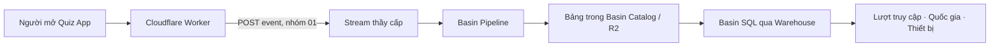

# Thu thập và thống kê truy cập Quiz ManhNhom trên Cloudflare

Nhóm: **01** · Ngày thực hiện: **20/10/2026**

## 1. Mục tiêu và tài liệu đã đối chiếu

Thống kê trong **24 giờ trượt gần nhất**: lượt mở website, quốc gia truy cập, loại thiết bị và số trình duyệt khác nhau ước tính. Không dùng số liệu demo thay thế truy cập thật.

Đã đọc `StreamInfo.docx` do người dùng cung cấp và tài liệu mẫu “Thu thập dữ liệu truy cập website bằng Cloudflare D1 — Anh Em Shop”. Tài liệu Anh Em Shop dùng Pages Functions và D1, không dùng Basin; đây là mẫu cách tổ chức bài, không phải lý do để tạo database D1 cho Quiz. StreamInfo là thông tin kỹ thuật của Stream thầy cấp, nên phương án thực hiện giữ **Workers + Basin Pipelines + Catalog + Basin SQL**. Không sử dụng tài khoản Admin của website mẫu, không sao chép nghiệp vụ bán hàng hoặc số liệu mẫu.

## 2. Giải thích ngắn: mình đang làm gì?

Mỗi khi một trình duyệt tải trang HTML thành công, Worker tạo một **event**. Worker gửi event bằng HTTP **POST** tới Stream. Pipeline của thầy chuyển event tới bảng trong Catalog. Sau đó dùng **Warehouse** để chạy Basin SQL, lọc 24 giờ và đếm dữ liệu.



Phần này không thay đổi PostgreSQL, API chấm điểm, đăng nhập hoặc nội dung đề thi.

## 3. Tài nguyên và schema đã xác nhận

Endpoint từ StreamInfo.docx:

```text
https://f8fb6f6f730b404fb2f273fd789d04df.ingest.cloudflare.com
```

| Trường | Schema thầy cấp | Cách dùng trong Quiz |
|---|---|---|
| `id` | string, không bắt buộc | Mã nhóm `01`, không phải ID lượt truy cập |
| `country` | string, không bắt buộc | Lấy từ `request.cf.country`, không biết thì null |
| `device` | string, không bắt buộc | `ios`, `android`, `pc`, `unknown` từ User-Agent |
| `time` | timestamp, unit **millisecond** | `Date.now()`; không chia cho 1000 |
| `ip` | string, không bắt buộc | null; không cần IP thô để đếm trình duyệt |
| `meta` | json, không bắt buộc | `event`, `event_id`, `visitor_id`, `site`, `path`, `is_test` |

Trong `meta`, `event_id` là UUID riêng của từng lượt; `visitor_id` là mã trình duyệt ngẫu nhiên; `site` là hostname Quiz để không trộn với website khác cùng Stream; `is_test` giúp loại dữ liệu thử khỏi báo cáo.

**Điểm cần sửa so với ví dụ:** số thời gian 10 chữ số trong tài liệu HTTP là dạng giây, nhưng schema ghi mili giây. Gửi số đó theo schema mili giây có thể thành thời gian năm 1970 và không xuất hiện trong truy vấn 24 giờ. Một địa chỉ IP ví dụ cũng không phải IPv4 hợp lệ; không dùng dữ liệu ví dụ đó làm dữ liệu người truy cập thật.

## 4. Định nghĩa chỉ số

| Chỉ số | Ý nghĩa và giới hạn |
|---|---|
| Lượt mở trang ghi nhận | Số event `page_view` của nhóm 01, đúng hostname, không phải test, trong cửa sổ 24 giờ |
| Quốc gia | Nhóm lượt theo mã nước; vị trí mạng gần đúng, không phải GPS |
| Loại thiết bị | Phân loại theo User-Agent; iPad dùng UA desktop hoặc bot có thể bị phân loại chưa chính xác |
| Trình duyệt khác nhau ước tính | `COUNT(DISTINCT visitor_id)`; một trình duyệt quay lại nhiều lần dùng cùng mã cookie |

Cookie `quiz_analytics_visitor` có `HttpOnly`, `Secure`, `SameSite=Lax`, thời hạn 30 ngày. Không chứa tên tài khoản, JWT, mật khẩu hoặc đáp án. Đây không phải định danh thiết bị vật lý: xóa cookie, dùng chế độ riêng tư hoặc trình duyệt khác có thể tạo mã mới. Vì vậy không ghi “chính xác số người/thiết bị”.

Quiz là SPA: chuyển màn hình bằng React không tải lại HTML. Phương án hiện tại đo lượt mở/tải lại website như mẫu Worker của thầy; không tự cộng mỗi lần bấm menu hoặc chọn đáp án. Các request JS/CSS/API, POST và lỗi HTTP không được đếm như lượt tải HTML thành công. Analytics gửi best effort bằng `waitUntil`, chưa có queue/retry nên không cam kết ghi đủ mọi lượt hoặc lọc toàn bộ bot.

## 5. Các bước thực hiện và file liên quan

### Bước 1 — Đọc source, không thay công nghệ của Quiz

Quiz đang chạy trên Cloudflare Workers Static Assets. Dùng Worker entrypoint để bao quanh việc phục vụ asset; không chuyển sang Pages, không thêm Hono chỉ để giống ảnh. Backend Spring Boot giữ nguyên.

### Bước 2 — Viết logic tạo và gửi event

`frontend/worker/analytics.mjs` lọc HTML GET thành công, đọc quốc gia ở Cloudflare, phân loại thiết bị, tạo mã lượt và trình duyệt. Gửi mảng JSON theo tài liệu HTTP Stream. Không lưu query string, JWT, mật khẩu, câu trả lời quiz hoặc IP thô. HTTP không thành công được ghi log lỗi tổng quát, không in dữ liệu nhạy cảm. Lỗi analytics không thay response của website.

`frontend/worker/index.mjs` chỉ export handler mặc định. Kiểm tra runtime local đã phát hiện việc export hằng số trực tiếp ở entrypoint không phù hợp Cloudflare; đã tách helper và chạy lại thành công.

### Bước 3 — Cấu hình Worker với tài nguyên có sẵn

`frontend/wrangler.jsonc`: thêm `main`, binding `ASSETS`, `run_worker_first`, endpoint và mã nhóm `01`. Không tạo bucket, Pipeline, D1 hoặc nâng gói. `ANALYTICS_ENABLED` được bật ở bước phát hành sau khi kiểm thử; không lưu token trong React hoặc Git. Stream đã nhận request demo không có token; không thay đổi cấu hình xác thực của tài nguyên thầy.

### Bước 4 — Cho người dùng tắt thống kê

`frontend/src/components/AnalyticsPrivacy.tsx` và Footer trang chủ hiển thị thông báo ngắn, nút tắt/bật. Cookie lựa chọn `quiz_analytics_optout` được giữ lại khi tải lại. Worker không gửi event hoặc cấp mã visitor mới khi đã tắt, khi có tín hiệu DNT hoặc Global Privacy Control. Nút tắt áp dụng các lượt sau, không xóa event đã gửi trước đó.

### Bước 5 — Tạo mẫu POST và thử đúng một event

`reset client/demo.http` có endpoint đã xác minh, mã nhóm `01`, `is_test: true`, không chứa thông tin đăng nhập. Trong VS Code REST Client, `{{$timestamp}}` trả giây; mẫu nối `000` để thành mili giây. Chỉ chạy một request, không Run All lặp lại. File này đang bị Git ignore theo cấu hình repository.

Đã gửi một event demo bằng Node với cùng schema vào Stream. Kết quả thực tế:

```json
{"success":true,"result":{"committed":1}}
```

- HTTP: **200**.
- Thời điểm gửi: **20/10/2026 08:00:41 GMT+7** (`2026-10-20T01:00:41.882Z`).
- `meta.event_id`: `demo-c46769b8-3e07-4c45-872e-f6b20dacf329`.
- `time`: `1792458041881` (mili giây).
- Dữ liệu VN/iOS trong event này là **dữ liệu thử**, không chứng minh có người dùng thật từ VN/iOS.
- Biên nhận: `backend/qa-results/basin-demo-result.json` (gitignored).

Kết quả xác nhận Stream đã nhận/commit một record. **Chưa xác nhận record đã xuất hiện trong bảng Catalog**: còn cần Warehouse, tên bảng và quyền đọc.

### Bước 6 — Kiểm thử trước khi phát hành

- 17 unit test Frontend đạt, gồm lọc request, timestamp mili giây, nhóm 01, payload POST array, xử lý lỗi, cookie, opt-out/DNT/GPC, query cách ly website và các kiểm tra Quiz hiện có.
- TypeScript và build Frontend đạt.
- Wrangler dry-run bundle/binding đạt.
- Worker local chạy thành công; HTML, JS, CSS và ảnh trả HTTP 200.
- Browser local tại 1366px, 1440px, 1920px và 390px đạt: Footer không tràn ngang, tắt/bật thống kê và lựa chọn giữ sau reload. Dữ liệu chủ đề trong lượt kiểm tra giao diện này được mock, analytics local tắt; không coi đây là kiểm thử truy vấn Warehouse.

### Bước 7 — Truy vấn 24 giờ đúng nhóm và website

Trước hết mở Warehouse thầy cấp, kiểm tra:

```sql
SHOW NAMESPACES;
-- Thay ten_namespace và ten_bang bằng tên thật:
SHOW TABLES IN ten_namespace;
DESCRIBE ten_namespace.ten_bang;
```

Sau khi có bảng thật, chạy ở thư mục `frontend`:

```powershell
node scripts/analytics-sql.cjs --table ten_namespace.ten_bang --group 01
```

Lệnh chỉ **in SQL**, không thực thi hoặc tự tạo bảng. Script tạo một cửa sổ UTC cố định `[bắt đầu, kết thúc)` dài 24 giờ, dùng `to_timestamp_millis(...)` so sánh với cột timestamp; đọc JSON bằng `json_get_str`/`json_get_bool` của Basin SQL. Không dùng `datetime('now','-24 hours')` của SQLite/D1 cho Basin.

Điều kiện bắt buộc trong các query thống kê:

```sql
id = '01'
AND json_get_str(meta, 'site') = 'quiz-app.quangmanh12082005.workers.dev'
AND json_get_str(meta, 'event') = 'page_view'
AND json_get_bool(meta, 'is_test') = false
```

Script xuất query tổng lượt, mã lượt riêng, số trình duyệt ước tính, nhóm quốc gia/thiết bị và danh sách event mới để đối chiếu. Không đếm `COUNT(DISTINCT id)` thành lượt/thiết bị vì `id` là mã nhóm cố định.

## 6. Còn thiếu và kết quả chưa được khẳng định

Chưa có tên Warehouse, namespace.table hoặc quyền truy vấn Catalog của thầy. Chưa có số liệu thật cho tổng lượt/quốc gia/thiết bị trong 24 giờ, chưa xác minh việc lưu bảng và chưa tạo dashboard Admin đọc Warehouse. Không đưa API token của thầy ra Frontend để làm dashboard.

Tài khoản CLI cá nhân từng trả lỗi `1021` khi liệt kê Pipelines vì cần Workers Paid. **Điều này không chặn POST vào Stream thầy cấp**, đã kiểm tra thành công. Không cần nâng gói cá nhân chỉ để gửi vào endpoint hiện có. Muốn query cần dùng đúng tài khoản/quyền thầy cấp.

Nếu thầy chỉ cấp endpoint: nhờ thầy cung cấp tên Warehouse và bảng hoặc chạy các query giúp nhóm 01. Không thể suy ra tên Warehouse từ hostname Stream. Không thể tái tạo lịch sử chưa được thu thập; sau khi bật thực tế chỉ báo cáo dữ liệu từ thời điểm bắt đầu.

## 7. Phát hành và kiểm chứng Production

- Đã deploy Worker + Frontend tại https://quiz-app.quangmanh12082005.workers.dev/; giữ domain, không đổi secret hoặc Backend.
- Phiên bản Cloudflare cuối: `41f9ec5b-2ebb-4f55-9535-38fb1cadea92`. `ANALYTICS_ENABLED=true`, mã nhóm `01`.
- Kiểm tra trực tiếp HTML/cookie và Footer tại Desktop 1440px, Mobile 390px đạt: HTTP 200, cookie HttpOnly/Secure, mã trình duyệt ổn định, opt-out giữ sau reload, không tràn ngang/JS error. Request QA có `x-quiz-analytics-test: 1`; các event tương ứng được gắn `meta.is_test=true` để loại khỏi thống kê thật.
- Ban đầu Worker gặp TypeError khi POST dù POST từ Node thành công. Đã dùng tail để xác định runtime Workers không hỗ trợ `redirect: error`. Sửa thành `manual`, từ chối response 3xx, giữ đúng receiver native fetch và kiểm thử lại. Không coi các bản chưa gửi thành công là thời gian thu thập đã được xác minh.
- **08:09:40 GMT+7 ngày 20/10/2026**: log request Production xác nhận `analytics_delivery`, `status:200`, `event_id:0ec89c36-c02a-40d6-8c3d-5ce2a6fc7cf7`.
- Biên nhận kiểm tra: `backend/qa-results/analytics-production-verification.json` (gitignored). Log này chỉ chứng minh Worker gọi được Stream; chưa chứng minh bảng Warehouse đã có dữ liệu.
- Có thể mở website từ điện thoại/máy tính để tạo lượt thật từ bây giờ. Không coi dữ liệu kiểm thử hoặc lịch sử trước mốc xác minh là số truy cập thực tế đã hoàn chỉnh.
- Backend Production chỉ được gọi GET để kiểm tra tương thích, trả HTTP 200 và có API nhiều đáp án đúng; không tạo bài làm hoặc tài khoản thử trong database Production.

### Cần người dùng/thầy cung cấp để chốt báo cáo số liệu

Tên **Warehouse**, **namespace.table** và cách vào tài khoản có quyền đọc, hoặc nhờ thầy chạy bộ query được chuẩn bị. Trường `id='01'` không phải tên Warehouse. Khi có quyền đọc, đối chiếu event test bằng ID ở trên rồi chạy query loại test để điền tổng lượt, quốc gia và trình duyệt ước tính. Hiện chưa có số liệu kết quả để công bố.

## 8. Nguồn

- `StreamInfo.docx` do người dùng cung cấp: endpoint/schema.
- Bài mẫu Anh Em Shop do người dùng cung cấp: cách mô tả, kiểm thử và báo cáo.
- https://developers.cloudflare.com/basin-pipelines/streams/writing-to-streams/
- https://developers.cloudflare.com/basin-pipelines/getting-started/
- https://developers.cloudflare.com/basin-sql/sql-reference/
- https://developers.cloudflare.com/basin-sql/sql-reference/scalar-functions/
- https://developers.cloudflare.com/workers/static-assets/routing/worker-script/
